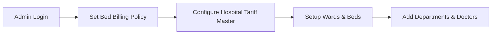
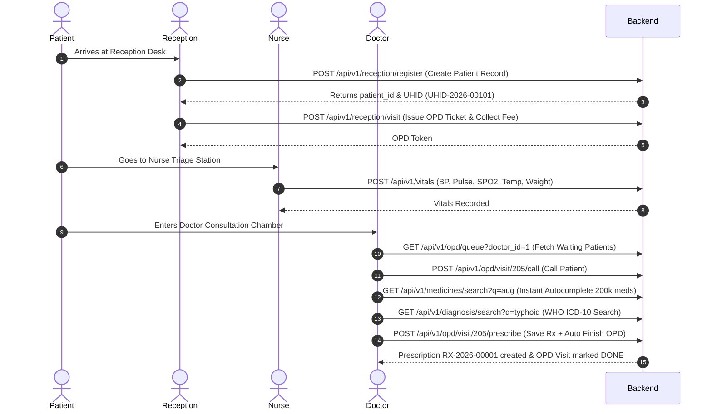
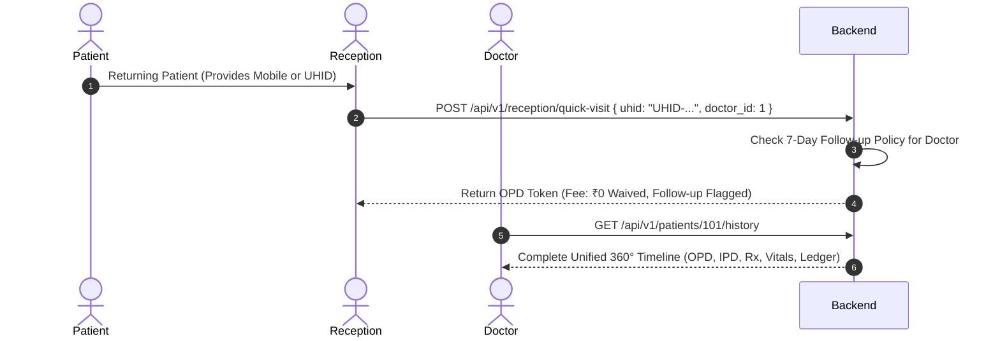
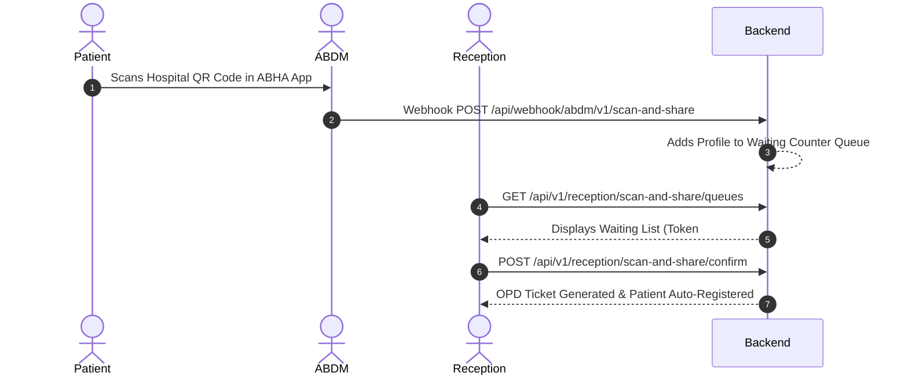
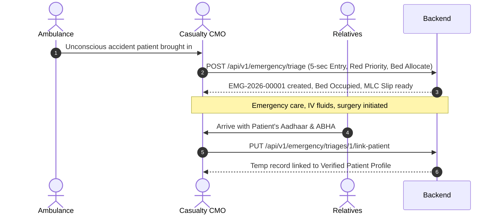
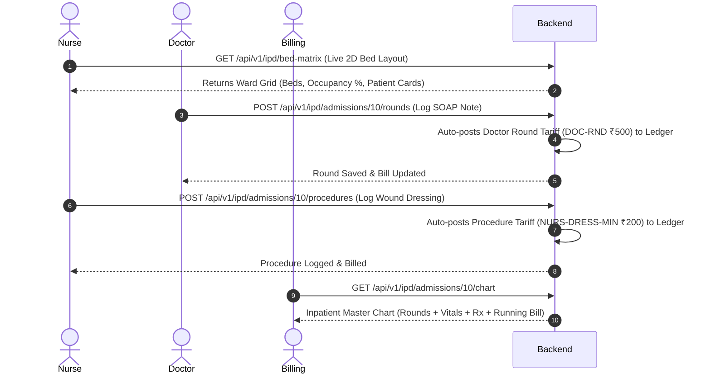
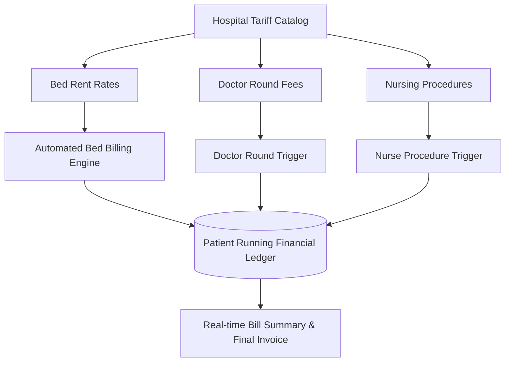

# 🏥 Complete Hospital Management System (HMS + ABDM) End-to-End API Workflow & Integration Guide

> **Target Audience:** Frontend Developers, Mobile App Developers, Backend Engineers, QA Testers & Hospital Operations Staff  
> **Base URL:** `http://localhost:8000/api/v1`  
> **Auth Type:** Bearer Token (Laravel Sanctum)  
> **Language/Format:** Step-by-Step Practical Workflow Guide with Request/Response Payloads, Business Logic & Mermaid Diagrams

---

## 📑 Table of Contents

1. [Global Configuration & Authentication](#1-global-configuration--authentication)
2. [Flow 0: Hospital Admin One-Time Setup & Configuration](#flow-0-hospital-admin-one-time-setup--configuration)
3. [Flow 1: New Walk-in Patient OPD Registration, Vitals & Consultation](#flow-1-new-walk-in-patient-opd-registration-vitals--consultation)
4. [Flow 2: Repeat Patient (Re-visit) & 360° Medical History Timeline](#flow-2-repeat-patient-re-visit--360-medical-history-timeline)
5. [Flow 3: ABDM Paperless Scan & Share Registration Flow](#flow-3-abdm-paperless-scan--share-registration-flow)
6. [Flow 4: Emergency (ER / Casualty) Fast-Track Triage Desk](#flow-4-emergency-er--casualty-fast-track-triage-desk)
7. [Flow 5: IPD Inpatient Care, Visual 2D Bed Matrix & Doctor SOAP Rounds](#flow-5-ipd-inpatient-care-visual-2d-bed-matrix--doctor-soap-rounds)
8. [Flow 6: Hospital Tariff Master, Automated Bed Billing & Running Ledger](#flow-6-hospital-tariff-master-automated-bed-billing--running-ledger)
9. [Frontend Screen-by-Screen Integration Guide](#frontend-screen-by-screen-integration-guide)
10. [Error Handling, HTTP Status Codes & Best Practices](#error-handling-http-status-codes--best-practices)
11. [Master API Cheat-Sheet Matrix](#master-api-cheat-sheet-matrix)

---

## 1. Global Configuration & Authentication

Har protected API request ke sath ye standard headers bhejna zaroori hai:

```http
Authorization: Bearer <ACCESS_TOKEN>
Content-Type: application/json
Accept: application/json
```

### 1.1 Login API
* **Kab Call Karein:** User app kholte hi login screen par credentials daalta hai tab.
* **HTTP Method & URL:** `POST /api/v1/login`
* **Request Payload:**
```json
{
  "email": "doctor@hospital.com",
  "password": "password123"
}
```
* **Response Payload (Success 200 OK):**
```json
{
  "success": true,
  "message": "Login successful",
  "data": {
    "token": "1|9f3d9b0c2a8e...",
    "user": {
      "id": 1,
      "name": "Dr. Rajesh Sharma",
      "email": "doctor@hospital.com",
      "hospital_id": 1,
      "roles": ["doctor"]
    }
  }
}
```
* **Frontend Action:** Token ko `localStorage` ya secure storage me store karein aur `axios`/`fetch` default headers me set karein.

---

## Flow 0: Hospital Admin One-Time Setup & Configuration

Hospital start hone par ya settings change hone par Admin system ko configure karta hai.



### Step 0.1: Configure Bed Billing Rules & Cycle
* **Kab Call Karein:** Hospital admin decide kare ki bed rent 24 ghante ke hisab se lagega ya calendar midnight par.
* **HTTP Method & URL:** `PUT /api/v1/hospital/settings/bed-billing`
* **Request Payload:**
```json
{
  "bed_billing_cycle": "admission_24h",
  "cutoff_time": "00:00",
  "grace_period_minutes": 120,
  "same_day_discharge_rule": "half_day",
  "auto_apply_nursing_with_bed": true
}
```
* **Supported Billing Cycle Rules:**
  - `admission_24h`: Patient jis waqt admit hua (e.g., 03:30 PM), agle din 03:30 PM par 1 din count hoga (120 min grace period ke sath).
  - `midnight`: Har calendar day raat 12:00 AM par bed charge count hoga.
  - `custom_cutoff`: Hospital ke custom time (e.g. 12:00 PM Noon) par cutoff count hoga.
  - `hourly`: ICU ya Daycare me per-hour proration lagega.

### Step 0.2: Setup Wards & Beds
* **Create Ward:** `POST /api/v1/wards`
```json
{
  "name": "Surgical ICU",
  "ward_type": "icu",
  "daily_charge": 6500.00
}
```
* **Create Bed:** `POST /api/v1/beds`
```json
{
  "ward_id": 1,
  "bed_number": "SICU-01",
  "daily_charge": 6500.00
}
```

### Step 0.3: Setup Hospital Tariff Master
* **Add Tariff Entry:** `POST /api/v1/billing/charges`
```json
{
  "category_id": 1,
  "code": "BED-ICU",
  "name": "Intensive Care Unit (ICU) Bed Rent",
  "billing_type": "per_day",
  "standard_rate": 6500.00,
  "tax_percentage": 0.00
}
```

---

## Flow 1: New Walk-in Patient OPD Registration, Vitals & Consultation

Naya patient hospital ke reception par walk-in aata hai, parcha banta hai, nurse vitals leti hai, doctor instant medicines autocomplete se prescription likhta hai aur visit close hoti hai.



### Step 1.1: Walk-in Patient Demographic Registration
* **Kab Call Karein:** Receptionist jab naye patient ka registration form submit kare.
* **HTTP Method & URL:** `POST /api/v1/reception/register`
* **Request Payload:**
```json
{
  "name": "Sunil Verma",
  "mobile": "9876543210",
  "gender": "M",
  "dob": "1992-05-14",
  "blood_group": "B+",
  "address": "Flat 202, Sector 15, Rohini",
  "city": "New Delhi",
  "guardian_name": "Ramesh Verma",
  "guardian_relation": "Father"
}
```
* **Response Payload (201 Created):**
```json
{
  "success": true,
  "message": "Patient registered successfully",
  "data": {
    "id": 101,
    "uhid": "UHID-2026-00101",
    "name": "Sunil Verma"
  }
}
```

### Step 1.2: Issue OPD Token Slip & Collect Consultation Fee
* **Kab Call Karein:** Patient register hone ke turant baad usko Doctor assign karke OPD parcha issue karne ke liye.
* **HTTP Method & URL:** `POST /api/v1/reception/visit`
* **Request Payload:**
```json
{
  "patient_id": 101,
  "doctor_id": 1,
  "department_id": 1,
  "chief_complaint": "High fever, chills, body ache for 3 days",
  "fee_charged": 500.00,
  "amount_paid": 500.00,
  "payment_method": "cash",
  "payment_status": "paid"
}
```
* **Response Payload (201 Created):**
```json
{
  "success": true,
  "message": "OPD visit created successfully",
  "data": {
    "id": 205,
    "opd_number": "OPD-2026-00205",
    "patient_id": 101,
    "doctor_id": 1,
    "queue_token": 1,
    "status": "waiting",
    "visit_date": "2026-09-15"
  }
}
```

### Step 1.3: Nurse Station Records Vitals
* **Kab Call Karein:** Nurse counter par patient ka BP, temperature aur oxygen check karne ke baad.
* **HTTP Method & URL:** `POST /api/v1/vitals`
* **Request Payload:**
```json
{
  "patient_id": 101,
  "opd_visit_id": 205,
  "encounter_type": "opd",
  "blood_pressure_sys": 120,
  "blood_pressure_dia": 80,
  "pulse_rate": 84,
  "oxygen_saturation": 98.5,
  "temperature": 101.4,
  "temperature_unit": "F",
  "respiratory_rate": 18
}
```

### Step 1.4: Doctor Views Waiting Queue & Calls Patient
* **Doctor Queue API:** `GET /api/v1/opd/queue?doctor_id=1`
* **Call Patient API:** `POST /api/v1/opd/visit/205/call`
  - *Effect:* Status update hota hai `in_consultation` me.

### Step 1.5: Fast Autocomplete on 2,00,000 Medicines & ICD-10 Codes
* **Instant Medicine Search (Brand, Salt Composition & Generic):**
  - **URL:** `GET /api/v1/medicines/search?q=augmentin`
  - **Response Payload:**
  ```json
  {
    "success": true,
    "data": [
      {
        "id": 4821,
        "brand_name": "Augmentin 625 Duo Tablet",
        "generic_name": "Amoxycillin (500mg) + Clavulanic Acid (125mg)",
        "salt_composition": "Amoxycillin (500mg) + Clavulanic Acid (125mg)",
        "form": "Tablet",
        "strength": "625mg",
        "mrp": 223.50
      }
    ]
  }
  ```
* **WHO ICD-10 Diagnosis Search (94,765 Codes):**
  - **URL:** `GET /api/v1/diagnosis/search?q=typhoid`
  - **Response Payload:**
  ```json
  {
    "success": true,
    "data": [
      {
        "code": "A01.0",
        "name": "Typhoid fever",
        "category": "Typhoid and paratyphoid fevers"
      }
    ]
  }
  ```

### Step 1.6: 1-Click Consultation Complete & Structured E-Prescription
* **Kab Call Karein:** Doctor medicines, dosages, advice daal kar **"Complete & Print Prescription"** button dabata hai.
* **HTTP Method & URL:** `POST /api/v1/opd/visit/205/prescribe`
* **Request Payload:**
```json
{
  "chief_complaints": "High grade fever with rigors for 3 days",
  "clinical_findings": "Febrile to touch, throat congested, chest clear",
  "advice": "Complete 5 days antibiotic course. Plenty of oral fluids.",
  "follow_up_date": "2026-09-20",
  "diagnoses": [
    {
      "icd_code": "A01.0",
      "diagnosis_name": "Typhoid fever",
      "diagnosis_type": "provisional"
    }
  ],
  "items": [
    {
      "medicine_name": "Augmentin 625 Duo Tablet",
      "dosage": "625mg",
      "frequency": "1-0-1",
      "duration_days": 5,
      "timing": "after_food",
      "instructions": "Take after meals with water"
    },
    {
      "medicine_name": "Dolo 650 Tablet",
      "dosage": "650mg",
      "frequency": "1-1-1",
      "duration_days": 3,
      "timing": "after_food",
      "instructions": "SOS in case of fever > 100 F"
    }
  ]
}
```
* **Auto-Execution Logic:**
  1. `prescriptions` table me `RX-2026-00001` banti hai.
  2. Structured items aur ICD-10 diagnoses record hote hain.
  3. `opd_visits` ka status `done` ho jata hai, `completed_at` timestamp set hota hai, primary diagnosis update hoti hai.
  4. Prescription print/PDF ready response wapas milta hai.

---

## Flow 2: Repeat Patient (Re-visit) & 360° Medical History Timeline

Agar patient pehle aa chuka hai aur dobara follow-up ke liye aata hai:
1. Receptionist ko lamba form nahi bharna padta—sirf **UHID ya Mobile number** enter karke 1-click token nikaal sakte hain.
2. System hospital ki **Free Follow-up Policy (e.g. 7 din)** automatically check karta hai. Agar 7 din ke andar same doctor ke pass aaya hai, toh ₹0 fee aur `waived` status auto-apply hota hai.
3. Doctor patient ka **360° Comprehensive Timeline** dekh sakta hai (purani visits, vitals graph, pehle likhi hui prescriptions, aur IPD history).



### Step 2.1: 1-Click Quick Re-visit Token Generation
* **Kab Call Karein:** Repeat patient reception par apna UHID ya registered Mobile number bataye.
* **HTTP Method & URL:** `POST /api/v1/reception/quick-visit`
* **Request Payload:**
```json
{
  "uhid": "UHID-2026-00101",
  "doctor_id": 1,
  "chief_complaint": "Follow-up post fever check"
}
```
* **Response Payload (201 Created):**
```json
{
  "success": true,
  "message": "Quick Re-visit Token Generated Successfully",
  "data": {
    "requires_selection": false,
    "visit": {
      "id": 206,
      "opd_number": "OPD-2026-00206",
      "queue_token": 2,
      "fee_charged": 0.0,
      "payment_status": "waived",
      "notes": "Free Follow-up Re-visit within 7 days (Previous visit: OPD-2026-00205)"
    },
    "revisit_info": {
      "is_revisit": true,
      "is_free_revisit": true,
      "previous_visit_id": 205,
      "previous_opd_number": "OPD-2026-00205",
      "previous_visit_date": "2026-09-15",
      "days_since_last_visit": 3,
      "validity_window_days": 7
    }
  }
}
```

### Step 2.2: Patient 360° Comprehensive Medical History Timeline
* **Kab Call Karein:** Doctor OPD me patient ko dekhne se pehle uski purani history ya previous prescriptions dekhna chahe.
* **HTTP Method & URL:** `GET /api/v1/patients/101/history`
* **Response Payload:**
```json
{
  "success": true,
  "data": {
    "patient": {
      "id": 101,
      "uhid": "UHID-2026-00101",
      "name": "Sunil Verma",
      "gender": "M",
      "blood_group": "B+",
      "mobile": "9876543210"
    },
    "summary": {
      "total_opd_visits": 2,
      "total_ipd_admissions": 0,
      "total_prescriptions": 1,
      "total_vitals_logged": 1,
      "is_currently_admitted": false,
      "first_visit_date": "2026-09-15",
      "last_visit_date": "2026-09-18",
      "known_diagnoses": ["A01.0 - Typhoid fever"],
      "billing": {
        "total_charged": 500.00,
        "unbilled_amount": 0.00,
        "billed_amount": 500.00
      }
    },
    "timeline": [
      {
        "event_type": "opd_visit",
        "id": 206,
        "timestamp": "2026-09-18T10:15:00",
        "title": "OPD Consultation - Dr. Rajesh Sharma (Cardiology)",
        "badge": "OPD",
        "color": "blue",
        "summary": "Follow-up post fever check",
        "meta": { "fee": "0.00", "status": "waiting" }
      },
      {
        "event_type": "prescription",
        "id": 1,
        "timestamp": "2026-09-15T11:45:00",
        "title": "Prescription RX-2026-00001 (Dr. Rajesh Sharma)",
        "badge": "Rx",
        "color": "emerald",
        "summary": "Augmentin 625 Duo Tablet, Dolo 650 Tablet"
      },
      {
        "event_type": "vital",
        "id": 1,
        "timestamp": "2026-09-15T11:20:00",
        "title": "Vitals Check (120/80 mmHg | 84 bpm | 98.5%)",
        "badge": "Vitals",
        "color": "amber",
        "summary": "120/80 mmHg | 84 bpm | 98.5%"
      }
    ]
  }
}
```

---

## Flow 3: ABDM Paperless Scan & Share Registration Flow

Patient apne ABHA mobile app (Aarogya Setu, ABHA App, Paytm) se hospital counter ka QR Code scan karta hai:



1. **Patient Scans QR:** ABDM Gateway calls webhook `POST /api/webhook/abdm/v1/scan-and-share`.
2. **Receptionist Fetches Queue:** `GET /api/v1/reception/scan-and-share/queues`
3. **Receptionist Assigns Doctor & Confirms:**
   * **Endpoint:** `POST /api/v1/reception/scan-and-share/confirm`
   * **Payload:**
   ```json
   {
     "queue_id": 482,
     "doctor_id": 1,
     "department_id": 1
   }
   ```

---

## Flow 4: Emergency (ER / Casualty) Fast-Track Triage Desk

Road traffic accident, trauma ya unconscious patient aane par:
1. **0 to 5 Second Fast Admission:** Bina reception line ke emergency triage desk par entry.
2. **Unidentified Patient Handling:** System automatically temporary UHID (`EMG-2026-XXXXX`) aur placeholder name `"Unknown Male (00001)"` generate karta hai.
3. **Emergency Severity Index (ESI):** 🔴 Red (Resuscitation), 🟡 Yellow (Urgent), 🟢 Green (Stable).
4. **MLC (Medico-Legal Case):** Police station name, constable buckle number daalte hi official **Police Intimation Memo (MLC Slip)** ban jati hai.
5. **Instant Bed Allotment:** Trauma/ER bed turant `occupied` mark ho jata hai.
6. **Post-Stabilization Patient Linking:** Patient ke hosh me aane par ya relatives aane par, 1 API call se pura case official ABHA/KYC record se merge/link ho jata hai bina koi data khoye.



### Step 4.1: 5-Second Emergency Fast-Track Admission
* **Kab Call Karein:** Casualty CMO ya Emergency Nurse jab critical patient receive kare.
* **HTTP Method & URL:** `POST /api/v1/emergency/triage`
* **Request Payload:**
```json
{
  "is_unknown_patient": true,
  "gender": "M",
  "approximate_age": 32,
  "priority_level": "red",
  "triage_category": "Trauma",
  "chief_complaint": "Severe head injury with active bleeding post motorcycle crash",
  "consciousness_level": "unresponsive",
  "gcs_score": 7,
  "brought_by": "Ambulance",
  "brought_by_contact": "108",
  "ward_id": 1,
  "bed_id": 5,
  "doctor_id": 3,
  "initial_vitals": {
    "bp_systolic": 85,
    "bp_diastolic": 55,
    "pulse": 130,
    "spo2": 89,
    "temperature": 98.0,
    "respiratory_rate": 26
  },
  "is_mlc": true,
  "police_station": "Outer Ring Road PS",
  "police_officer_name": "HC Virender",
  "police_buckle_number": "HC-992",
  "incident_place": "Near Metro Pillar 140",
  "mlc_injuries_details": "Deep scalp laceration 8cm x 3cm, compound fracture left tibia"
}
```
* **Response Payload (201 Created):**
```json
{
  "success": true,
  "message": "Emergency triage admission successful",
  "data": {
    "id": 1,
    "triage_number": "EMG-2026-00001",
    "priority_level": "red",
    "is_mlc": true,
    "mlc_number": "MLC-2026-00001",
    "status": "under_treatment",
    "patient": {
      "id": 102,
      "uhid": "EMG-2026-00001",
      "name": "Unknown Male (00001)"
    },
    "bed": {
      "id": 5,
      "bed_number": "SICU-01",
      "status": "occupied"
    }
  }
}
```

### Step 4.2: Live Emergency Dashboard with Priority Counters
* **Kab Call Karein:** ER Screen par Red/Yellow/Green cases aur active patients ka live count dekhne ke liye.
* **HTTP Method & URL:** `GET /api/v1/emergency/triages`
* **Response Payload:**
```json
{
  "success": true,
  "data": {
    "counters": {
      "total_today": 14,
      "red_priority": 2,
      "yellow_priority": 7,
      "green_priority": 5,
      "active_in_er": 8,
      "mlc_cases": 4
    },
    "triages": {
      "data": [
        {
          "id": 1,
          "triage_number": "EMG-2026-00001",
          "priority_level": "red",
          "is_mlc": true,
          "patient": { "name": "Unknown Male (00001)", "uhid": "EMG-2026-00001" },
          "bed": { "bed_number": "SICU-01" },
          "status": "under_treatment"
        }
      ]
    }
  }
}
```

### Step 4.3: Generate Police Intimation Memo (MLC Slip)
* **Kab Call Karein:** Police officer ke aane par Medico-Legal Case intimation slip print karne ke liye.
* **HTTP Method & URL:** `GET /api/v1/emergency/triages/1/mlc-slip`
* **Response Payload:** Contains official hospital declaration, police station, buckle number, injury markings, CMO signature block, ready for immediate print or PDF export.

### Step 4.4: Post-Stabilization Patient Identity Linking
* **Kab Call Karein:** Jab patient ke ghar wale aakar Aadhaar/ABHA card dete hain.
* **HTTP Method & URL:** `PUT /api/v1/emergency/triages/1/link-patient`
* **Request Payload (Option A - Update Temporary Profile with Verified Info):**
```json
{
  "name": "Amit Kumar Saxena",
  "mobile": "9811223344",
  "dob": "1994-03-21",
  "gender": "M",
  "blood_group": "O+",
  "address": "House 45, Civil Lines",
  "abha_number": "14-5566-7788-9900"
}
```
* **Request Payload (Option B - Link to Existing Patient ID):**
```json
{
  "target_patient_id": 105
}
```
* **Result:** Bed admission, vitals, medicines aur running bill automatically verified patient record me seamlessly shift ho jate hain.

---

## Flow 5: IPD Inpatient Care, Visual 2D Bed Matrix & Doctor SOAP Rounds

Admit hone ke baad patient ki inpatient journey:
1. **Live 2D Visual Bed Matrix:** Wards aur beds ka live color-coded status (🟢 Green = Vacant, 🔴 Red = Occupied, 🟡 Amber = Maintenance).
2. **Doctor Daily Inpatient Rounds (SOAP):** Doctor bedside jakar SOAP note likhta hai (Subjective, Objective, Assessment, Plan) aur Doctor Round Fee automatically ledger me judti hai.
3. **Bedside Nursing Procedures:** Nurse wound dressing, nebulization ya catheterization karti hai aur service charge patient ke ledger me auto-post hota hai.
4. **Inpatient 360° Comprehensive Chart:** Rounds, Vitals, Medications aur Live Financial Balance ka single master view.



### Step 5.1: Live 2D Visual Bed Matrix
* **Kab Call Karein:** Ward screen kholne par live beds ka visual grid dikhane ke liye.
* **HTTP Method & URL:** `GET /api/v1/ipd/bed-matrix`
* **Response Payload:**
```json
{
  "success": true,
  "data": {
    "overview": {
      "total_beds": 50,
      "available_beds": 35,
      "occupied_beds": 15,
      "occupancy_percentage": 30.0
    },
    "wards": [
      {
        "id": 1,
        "name": "Surgical ICU",
        "ward_type": "icu",
        "total_beds": 10,
        "available_beds": 4,
        "occupied_beds": 6,
        "beds": [
          {
            "id": 1,
            "bed_number": "SICU-01",
            "status": "occupied",
            "daily_charge": 6500.0,
            "admission": {
              "id": 10,
              "ipd_number": "IPD-2026-00010",
              "admission_type": "planned",
              "elapsed_days": 2,
              "elapsed_hours": 48,
              "patient": {
                "name": "Devendra Pratap",
                "uhid": "UHID-2026-00088",
                "gender": "M",
                "age": 42
              },
              "doctor": {
                "name": "Dr. Ananya Roy",
                "specialization": "General Surgeon"
              },
              "running_bill": 14500.00
            }
          },
          {
            "id": 2,
            "bed_number": "SICU-02",
            "status": "available",
            "daily_charge": 6500.0,
            "admission": null
          }
        ]
      }
    ]
  }
}
```

### Step 5.2: Doctor Bedside SOAP Rounds & Auto-Fee Trigger
* **Kab Call Karein:** Doctor roz subah ward round me patient ka clinical evaluation kare.
* **HTTP Method & URL:** `POST /api/v1/ipd/admissions/10/rounds`
* **Request Payload:**
```json
{
  "doctor_id": 1,
  "round_type": "routine",
  "subjective": "Patient reports pain decreased from 7/10 to 3/10, slept well, passed flatus",
  "objective": "Abdomen soft, non-tender. Surgical drain 40ml serous fluid. Dressing clean & dry.",
  "assessment": "Post-op Day 2 Lap Cholecystectomy, recovery progressing well",
  "plan": "Remove surgical drain tomorrow morning, start oral semi-solid diet, encourage ambulation",
  "diet_advice": "soft",
  "clinical_condition": "improving",
  "is_discharge_planned": true,
  "planned_discharge_date": "2026-09-17"
}
```
* **Auto-Execution Logic:**
  1. SOAP Note database me store hoti hai.
  2. System hospital tariff catalog se Doctor Round Fee (`DOC-RND` ₹500) patient ke running financial ledger me auto-post kar deta hai!

### Step 5.3: Bedside Nursing Procedure Log & Auto-Billing
* **Kab Call Karein:** Duty nurse patient ka dressing change, nebulization ya IV line lagaye.
* **HTTP Method & URL:** `POST /api/v1/ipd/admissions/10/procedures`
* **Request Payload:**
```json
{
  "procedure_name": "Wound Dressing (Minor)",
  "procedure_code": "NURS-DRESS-MIN",
  "performed_by_name": "Nurse Sunita",
  "notes": "Laparoscopy port sites cleaned with betadine, sterile dressing applied"
}
```
* **Auto-Execution Logic:**
  1. Procedure log create hota hai.
  2. Procedure tariff (₹200) automatically ledger me `unbilled` item ban jata hai.

### Step 5.4: Inpatient 360° Comprehensive Chart
* **Kab Call Karein:** Head Doctor ya Inpatient Floor Manager patient ki complete file open kare.
* **HTTP Method & URL:** `GET /api/v1/ipd/admissions/10/chart`
* **Contains:** Admission info, all SOAP rounds history, all nursing procedures, vitals trend line, active prescriptions, and live ledger balance.

---

## Flow 6: Hospital Tariff Master, Automated Bed Billing & Running Ledger

Hospital me sabhi services ka catalog aur daily midnight bed charges calculate karne ka system:



### Step 6.1: Automated Bed Billing Engine
* **Command Line (Scheduled Cron):** `php artisan hospital:apply-bed-charges`
* **API Trigger:** `POST /api/v1/billing/charges/apply-bed-charges`
* **Kaise Kaam Karta Hai:**
  1. Sabhi active admitted patients ko fetch karta hai.
  2. Hospital ki bed billing settings check karta hai (`admission_24h` allotment timestamp vs `midnight`).
  3. Elapsed time calculate karke dekhta hai kitne din ka charge lagna chahiye aur already kitna laga hai.
  4. Pending dinon ka Bed Rent aur Daily Nursing charge auto-post kar deta hai.

### Step 6.2: View Patient Running Ledger & Billing Summary
* **Kab Call Karein:** Billing counter par patient ka live balance dekhna ho ya discharge se pehle bill verify karna ho.
* **HTTP Method & URL:** `GET /api/v1/billing/ledger/patient/101?encounter_type=ipd`
* **Response Payload:**
```json
{
  "success": true,
  "data": {
    "summary": {
      "gross_amount": 16700.00,
      "discount_amount": 500.00,
      "tax_amount": 0.00,
      "net_payable": 16200.00,
      "unbilled_total": 16200.00,
      "billed_total": 0.00
    },
    "items": [
      {
        "id": 1,
        "item_name": "ICU Bed Daily Rent",
        "category": "bed_charges",
        "quantity": 2,
        "unit_rate": 6500.00,
        "total_amount": 13000.00,
        "status": "unbilled"
      },
      {
        "id": 2,
        "item_name": "Doctor Inpatient Daily Round",
        "category": "doctor_visit",
        "quantity": 2,
        "unit_rate": 500.00,
        "total_amount": 1000.00,
        "status": "unbilled"
      },
      {
        "id": 3,
        "item_name": "Daily Routine Nursing Care",
        "category": "nursing_care",
        "quantity": 2,
        "unit_rate": 1000.00,
        "total_amount": 2000.00,
        "status": "unbilled"
      },
      {
        "id": 4,
        "item_name": "Wound Dressing (Minor)",
        "category": "nursing_care",
        "quantity": 1,
        "unit_rate": 200.00,
        "total_amount": 200.00,
        "status": "unbilled"
      }
    ]
  }
}
```

### Step 6.3: Cancel an Accidental Ledger Entry
* **Kab Call Karein:** Agar staff ne galti se kisi aur patient par koi charge laga diya ho.
* **HTTP Method & URL:** `POST /api/v1/billing/ledger/{item_id}/cancel`
* **Request Payload:**
```json
{
  "reason": "Wrong patient selected by nursing staff"
}
```

---

## Frontend Screen-by-Screen Integration Guide

Ye table frontend developers ko batati hai ki **kaun si screen par kaun si API call hogi, kab hogi, aur button click par kya response handle karna hai**:

| Frontend Screen | Action / Trigger | API Called | Request Data / Purpose | Next Screen / Action |
|---|---|---|---|---|
| **Login Screen** | "Sign In" button click | `POST /api/v1/login` | `{ email, password }` | Save token in storage, redirect to dashboard by role |
| **Admin Settings Screen** | "Save Bed Rules" click | `PUT /api/v1/hospital/settings/bed-billing` | `{ bed_billing_cycle: "admission_24h", ... }` | Show success toast message |
| **Reception Walk-in Screen** | Page load | `GET /api/v1/reception/departments` | None (load doctors list) | Populate Doctor & Department dropdowns |
| **Reception Walk-in Screen** | "Register Patient" click | `POST /api/v1/reception/register` | Demographics `{ name, mobile, gender, dob, ... }` | Receive `patient_id` & `uhid`, open OPD slip form |
| **Reception OPD Slip Screen** | "Generate OPD Token" click | `POST /api/v1/reception/visit` | `{ patient_id, doctor_id, fee_charged, ... }` | Print OPD Ticket (Token #1), route patient to triage |
| **Reception Quick Re-visit** | Enter UHID/Phone & click "Check" | `POST /api/v1/reception/quick-visit` | `{ uhid: "UHID-...", doctor_id: 1 }` | If `< 7 days`, shows ₹0 fee waived automatically! Print token |
| **Nurse Station Vitals** | "Save Vitals" click | `POST /api/v1/vitals` | `{ bp_sys, bp_dia, pulse, spo2, temp }` | Show green tick, alert doctor queue |
| **Doctor OPD Chamber** | Page load (Auto-poll 15s) | `GET /api/v1/opd/queue?doctor_id=1` | None | Render waiting queue cards |
| **Doctor OPD Chamber** | "Call Patient" button | `POST /api/v1/opd/visit/{id}/call` | None | Update patient status to "In Chamber" |
| **Doctor Consultation** | Med input typing (`>= 2` chars) | `GET /api/v1/medicines/search?q=...` | Query string (e.g. `aug`) | Render fast dropdown with Brand, Salt, MRP |
| **Doctor Consultation** | ICD-10 typing (`>= 2` chars) | `GET /api/v1/diagnosis/search?q=...` | Query string (e.g. `fever`) | Render WHO ICD-10 diagnosis dropdown |
| **Doctor Consultation** | "Complete & Prescribe" click | `POST /api/v1/opd/visit/{id}/prescribe` | Structured Rx payload (Items, ICDs, Advice) | Print Prescription preview modal, remove from waiting queue |
| **Patient Profile View** | Open Patient Timeline tab | `GET /api/v1/patients/{id}/history` | None | Render chronological 360° timeline & summary counters |
| **Emergency Triage Desk** | Page load | `GET /api/v1/emergency/triages` | None | Render Red/Yellow/Green cards & active ER count |
| **Emergency Triage Desk** | "5-Sec Fast Admit" click | `POST /api/v1/emergency/triage` | Fast payload (Temp UHID, Bed, ESI Red, MLC) | Print emergency wristband & MLC police slip |
| **Emergency Patient Desk** | "Print MLC Slip" click | `GET /api/v1/emergency/triages/{id}/mlc-slip` | None | Open printable Police Intimation Memo |
| **Emergency Patient Desk** | "Link KYC / ABHA" click | `PUT /api/v1/emergency/triages/{id}/link-patient` | `{ target_patient_id }` or `{ name, abha, ... }` | Merge records, update screen without data loss |
| **IPD Ward Bed Grid** | Page load (Auto-poll 30s) | `GET /api/v1/ipd/bed-matrix` | None | Render 2D visual bed layout (🟢 Vacant, 🔴 Occupied) |
| **Doctor Inpatient Round** | "Submit SOAP Note" click | `POST /api/v1/ipd/admissions/{id}/rounds` | SOAP payload `{ subjective, objective, ... }` | Toast: "Round saved & ₹500 fee added to ledger" |
| **Nurse Bedside Care** | "Log Procedure" click | `POST /api/v1/ipd/admissions/{id}/procedures` | `{ procedure_code, procedure_name, ... }` | Toast: "Procedure saved & billed to ledger" |
| **Inpatient Master Chart** | Click on any occupied bed | `GET /api/v1/ipd/admissions/{id}/chart` | None | Open drawer with Rounds, Vitals, Rx, and Ledger |
| **Billing / Discharge Desk** | Click "View Ledger" | `GET /api/v1/billing/ledger/patient/{id}` | `?encounter_type=ipd` | Display itemized breakdown and net balance |

---

## Error Handling, HTTP Status Codes & Best Practices

Backend standardized JSON format me response bhejta hai:

### Standard Error Response Format
```json
{
  "success": false,
  "message": "Validation failed",
  "errors": {
    "doctor_id": [
      "The selected doctor is currently inactive or not found."
    ]
  }
}
```

### HTTP Status Codes Guide for Frontend
* **`200 OK`**: Request successful (GET requests, updates, cancellations).
* **`201 Created`**: New record created (Patient registered, OPD visit, Prescription, Emergency triage).
* **`400 Bad Request`**: Invalid business condition (e.g. bed already occupied, invalid OTP).
* **`401 Unauthorized`**: Bearer token expired ya missing — redirect user to Login Screen.
* **`403 Forbidden`**: Role permission issue (e.g. nurse trying to write doctor SOAP note).
* **`404 Not Found`**: Patient ID, Bed ID, ya Visit ID database me nahi mila.
* **`422 Unprocessable Entity`**: Form validation error — fields ke niche red text me error dikhayein.
* **`500 Internal Server Error`**: Unexpected server exception.

---

## Master API Cheat-Sheet Matrix

| Module | Method | Endpoint | Primary Purpose |
|---|---|---|---|
| **Auth** | `POST` | `/api/v1/login` | User login (Sanctum Bearer token) |
| **Settings** | `GET/PUT` | `/api/v1/hospital/settings/bed-billing` | 24h vs Midnight vs Custom cutoff bed billing rules |
| **Reception** | `POST` | `/api/v1/reception/register` | Walk-in patient demographic registration |
| **Reception** | `POST` | `/api/v1/reception/visit` | Create OPD token / slip with split payment |
| **Reception** | `POST` | `/api/v1/reception/quick-visit` | **1-Click Re-visit Token** (with 7-day free follow-up validation) |
| **Reception** | `GET` | `/api/v1/reception/departments` | Departments & Doctors listing for dropdowns |
| **Medicines** | `GET` | `/api/v1/medicines/search?q=...` | **2,00,000 Medicines Fast Autocomplete** (Brand, Salt, Generic) |
| **Diagnosis** | `GET` | `/api/v1/diagnosis/search?q=...` | **94,765 WHO ICD-10 Search** |
| **OPD** | `GET` | `/api/v1/opd/queue` | Doctor's active OPD queue |
| **OPD** | `POST` | `/api/v1/opd/visit/{id}/call` | Call patient into consultation room |
| **OPD** | `POST` | `/api/v1/opd/visit/{id}/prescribe` | **Doctor 1-Click Consultation + E-Prescription** |
| **Timeline** | `GET` | `/api/v1/patients/{id}/history` | **Patient 360° Unified Medical Timeline** |
| **Emergency**| `POST` | `/api/v1/emergency/triage` | **5-Second Casualty Fast-Track** (Temp UHID, ESI Red/Yellow/Green, Bed) |
| **Emergency**| `GET` | `/api/v1/emergency/triages` | Live ER desk with Red, Yellow, Green, MLC live counters |
| **Emergency**| `PUT` | `/api/v1/emergency/triages/{id}/link-patient` | Post-stabilization ABHA / KYC Patient Linking |
| **Emergency**| `GET` | `/api/v1/emergency/triages/{id}/mlc-slip` | **Official Police Intimation Memo (MLC Slip)** |
| **IPD** | `GET` | `/api/v1/ipd/bed-matrix` | **Live 2D Visual Bed Matrix** (🟢 Available, 🔴 Occupied, 🟡 Maint) |
| **IPD** | `POST` | `/api/v1/ipd/admissions/{id}/rounds` | **Doctor Daily SOAP Round** + Auto Doctor Visit Fee Trigger |
| **IPD** | `POST` | `/api/v1/ipd/admissions/{id}/procedures` | **Bedside Nursing Procedure** + Auto Charge Trigger |
| **IPD** | `GET` | `/api/v1/ipd/admissions/{id}/chart` | **Inpatient 360° Master Chart** (Rounds, Vitals, Meds, Ledger) |
| **Billing** | `GET/POST`| `/api/v1/billing/charges` | Hospital Tariffs Catalog Master |
| **Billing** | `POST` | `/api/v1/billing/charges/apply-bed-charges` | Daily Bed Rent & Nursing Calculation Engine Trigger |
| **Billing** | `GET` | `/api/v1/billing/ledger/patient/{patientId}` | Patient Running Financial Ledger Summary |
| **Billing** | `POST` | `/api/v1/billing/ledger/{id}/cancel` | Cancel an accidental billing ledger item |
