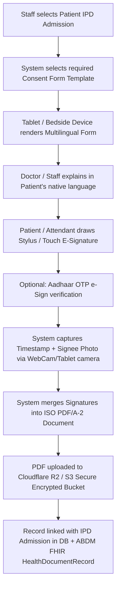

# Complete Hospital Patient Consents, Legal Declarations & NABH Documentation List

> **Applicability:** NABH (5th Edition), ABDM, and Indian Legal Framework (Consumer Protection Act, Indian Medical Council Regulations, MCI/NMC Guidelines)  
> **Purpose:** Comprehensive Master Catalog of all legal, clinical, and administrative consent documents required from patients/attendants during hospital stay.

---

## 1. Master Consent Catalog & Department Matrix

| Category | Form Code | Document Name | Mandatory / Occasion | Signatory Required |
| :--- | :--- | :--- | :--- | :--- |
| **Admission & General** | `ADM-01` | General Admission Consent & Conditions of Stay | At Admission (IPD/Day Care) | Patient or Primary Guardian |
| **Admission & General** | `ADM-02` | Financial Undertaking & Tariff Acknowledgment | At Admission | Patient / Financially Responsible Party |
| **Admission & General** | `ADM-03` | ABDM ABHA Data Sharing Consent | ABHA Linking / Scan & Share | Patient (Digital OTP or Physical Sign) |
| **Admission & General** | `ADM-04` | Patient Rights & Responsibilities Charter | At Admission | Patient / Attendant Acknowledgment |
| **Emergency & Critical** | `EMG-01` | High-Risk Treatment & ICU Admission Consent | Shift to ICU / Unstable Patient | Attendant / Next of Kin |
| **Emergency & Critical** | `EMG-02` | Invasive Line Placement Consent (Central Line/Ventilator) | Prior to Procedure | Attendant / Next of Kin |
| **Emergency & Critical** | `EMG-03` | Medico-Legal Case (MLC) Intimation Form | Accident / Assault / Poisoning | RMO / Police Constable / Attendant |
| **Surgical & OT** | `SUR-01` | Informed Consent for Surgery / Operative Procedure | Pre-Operative (Min 4 hrs prior) | Patient + Surgeon + Witness |
| **Surgical & OT** | `SUR-02` | Informed Consent for Anesthesia (GA / SA / Local / Epidural) | During PAC Checkup | Patient / Guardian + Anesthetist |
| **Surgical & OT** | `SUR-03` | Blood & Blood Component Transfusion Consent | Prior to PRBC/FFP/Platelets | Patient / Guardian |
| **Surgical & OT** | `SUR-04` | High-Risk Surgical Consent (Special Hazard / ASA III-V) | Morbid / Critical Patients | Attendant (2 Adult Relatives) + Surgeon |
| **Surgical & OT** | `SUR-05` | Consent for Disposal / Histopathology of Removed Tissue/Organ | Intra-Op / Post-Op | Patient / Relative |
| **Diagnostic & Labs** | `DIA-01` | Contrast-Enhanced CT / MRI (CECT) Consent | Prior to IV Contrast Dye Injection | Patient / Guardian (Creatinine verified) |
| **Diagnostic & Labs** | `DIA-02` | HIV Pre- & Post-Test Counseling Consent | Prior to Screening | Patient |
| **Diagnostic & Labs** | `DIA-03` | High-Risk Diagnostic Biopsy Consent (Liver/Kidney/Bone Marrow) | Prior to Biopsy | Patient / Relative + Radiologist/Pathologist |
| **Maternity & Neonatal** | `MAT-01` | Consent for Normal Delivery / Cesarean Section (LSCS) | Prior to Labor Room Admission | Patient + Spouse / Primary Relative |
| **Maternity & Neonatal** | `MAT-02` | Tubectomy / Vasectomy Sterilization Consent | Under National Family Planning Guidelines | Patient + Spouse |
| **Maternity & Neonatal** | `MAT-03` | NICU High-Risk Care & Surfactant Therapy Consent | Pre-Term / Critical Neonate | Father / Mother / Guardian |
| **Discharge & Departure** | `DIS-01` | Discharge Summary & Medication Handover Acknowledgment| At Normal Discharge | Patient / Attendant |
| **Discharge & Departure** | `DIS-02` | DAMA / LAMA (Discharge Against Medical Advice) | Leaving against doctor advice | Patient / Attendant + 2 Independent Witnesses |
| **Discharge & Departure** | `DIS-03` | DNR / DNAR (Do Not Resuscitate) Declaration | Terminal Care / Palliative Care | Family / Authorized Decision Maker |
| **Post-Mortem & Mortuary**| `MOR-01` | Body Handover Declaration & Death Intimation | In Case of Expiry | Family Member / Police (for MLC) |

---

## 2. Detailed Structure of Crucial Consent Forms

### 2.1 General Admission & Financial Undertaking (`ADM-01` & `ADM-02`)
* **Purpose:** Grants doctors permission to conduct physical examinations, routine nursing care, and emergency first-aid; legally binds the guarantor for all incurred hospital bills.
* **Key Clauses Included:**
  1. Consent for routine nursing procedures, IV cannulation, diagnostic blood draws.
  2. Acknowledgment of hospital room rates, doctor visit slabs, and estimated surgery cost.
  3. Patient Responsibility for Valuables & Cash (Hospital not liable for lost belongings).
  4. Camera/CCTV Surveillance consent for ICU and corridor safety.

### 2.2 Informed Consent for Surgery & Anesthesia (`SUR-01` & `SUR-02`)
* **Purpose:** Mandatory under Indian Supreme Court Guidelines (*Samira Kohli vs Dr. Prabha Manchanda*). Blanket consents are legally invalid; the consent must be **procedure-specific**.
* **Mandatory Fields:**
  * Exact Name of Procedure in medical terms & plain language explained to patient in their mother tongue (e.g., Hindi, English, etc.).
  * Anticipated Benefits, Material Risks & Complications (Infection, Bleeding, Organ Injury).
  * Reasonable Alternative Treatments (Medical management vs Surgery).
  * Consent to extend the operation if unforeseen life-threatening conditions arise.
  * Surgeon's declaration stating that risks have been explained.
  * Patient/Relative signature + Signature of an independent third-party **Witness**.

### 2.3 Blood Transfusion Consent (`SUR-03`)
* **Purpose:** Informed consent for transfusion of Whole Blood, Packed Red Blood Cells (PRBC), Fresh Frozen Plasma (FFP), or Platelets.
* **Key Clauses:** Explanation of rare transfusion reactions, febrile non-hemolytic reactions, and risk of window-period viral transmission (HIV, Hepatitis B/C).

### 2.4 Contrast Media (CECT / MRI Contrast) Consent (`DIA-01`)
* **Purpose:** Mandatory prior to administering iodinated or gadolinium contrast media in Radiology.
* **Checkpoints:** Previous history of asthma/allergy, diabetic status (Metformin stoppage), Serum Creatinine / eGFR within normal limits.

### 2.5 DAMA / LAMA (Discharge Against Medical Advice) Form (`DIS-02`)
* **Purpose:** Highest legal protection for hospital when a critically ill or unstable patient leaves voluntarily against doctor advice.
* **Legal Shield Clauses:**
  1. Patient/Relative explicitly acknowledges that leaving may result in severe complications, permanent disability, or death.
  2. Hospital and treating doctors are completely indemnified from any legal liability after the patient steps out of the premises.
  3. Signatures of 2 independent hospital witnesses with time and date.

### 2.6 ABDM ABHA Data Sharing & Consent Artifact (`ADM-03`)
* **Purpose:** Digital consent under National Health Data Management Policy.
* **Components:**
  * Consent to link hospital records with 14-digit ABHA Number.
  * Choice of record types shared: Diagnostic reports, prescriptions, discharge summary.
  * Validity period and right to revoke consent anytime via patient's ABHA App.

---

## 3. How the HMS Digitalizes Consents (E-Sign & Archival)

