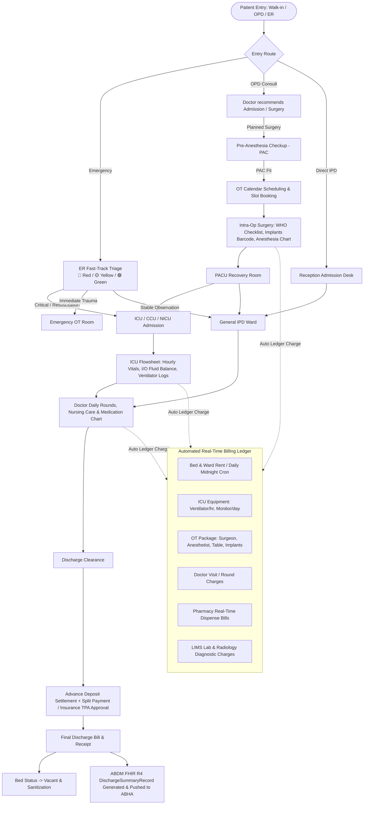

# Hospital Critical Care, IPD, ICU, OT & Integrated Billing System

> **Document Version:** 1.0  
> **Applicability:** Multi-Specialty Hospital Information System (HMIS) with ABDM M1, M2 & M3 Compliance  
> **Modules Covered:** Emergency (ER), IPD, ICU, Operation Theatre (OT), Pharmacy, Lab (LIS), Real-Time Billing & Discharge  

---

## 1. End-to-End Operational Lifecycle & Flowchart



---

## 2. Emergency (ER / Casualty) Workflow

### 2.1 Triage Categorization (ESI - Emergency Severity Index)
* **🔴 Red (Priority 1 - Resuscitation):** Immediate life-saving intervention (Cardiac arrest, Severe trauma, Shock). Instant temporary UHID (`EMG-TEMP-XXXX`) generated in 5 seconds.
* **🟡 Yellow (Priority 2 - Emergent):** High risk, altered mental state, severe pain, asthma attack. Max wait time: 10 minutes.
* **🟢 Green (Priority 3 - Non-Urgent):** Stable vitals, minor fractures, suturing, high fever. Normal registration.

### 2.2 Medico-Legal Case (MLC) Protocol
* Automatic MLC flag triggers when emergency reason is: RTA (Road Traffic Accident), Assault, Poisoning, Burns, Firearm, Hanging.
* Captures: Brought by (Police / Relative / Good Samaritan), Police Station, Constable Badge No, DD/FIR Entry No.
* Generates printable **MLC Intimation Slip** & **Injury Report**.

### 2.3 Emergency Drug Crash-Cart
* Emergency drugs (Adrenaline, Atropine, Norad, Amiodarone) dispensed immediately without waiting for billing counter clearance. Charges auto-posted to patient ER running ledger.

---

## 3. ICU (Intensive Care Unit / CCU / HDU / NICU) Workflow

### 3.1 Equipment & Life-Support Mapping
* ICU beds are digitally linked with physical devices:
  * Ventilator (Serial #, Mode: CPAP, BiPAP, SIMV, FiO2 %, PEEP)
  * Multi-para Monitor (Heart Rate, NIBP, IBP, SpO2, Temperature)
  * Syringe Infusion Pumps (Drug name, ml/hr rate, total volume infused)

### 3.2 Hourly Flowsheet & Charting
* **Vitals Log (Every 1 to 2 hours):** Heart Rate, BP (Systolic/Diastolic/MAP), SpO2, Respiratory Rate, Temperature, CVP (Central Venous Pressure).
* **Neurological GCS Chart (Glasgow Coma Scale):**
  * Eye Opening (1-4), Verbal Response (1-5), Motor Response (1-6) → Total /15.
* **Arterial Blood Gas (ABG) Tracker:** pH, pO2, pCO2, HCO3, Lactate, Base Excess.

### 3.3 Strict Intake & Output (I/O) Fluid Balance Matrix
* **Intake (Input ml):** IV Infusions, Normal Saline/Ringer Lactate, Blood Products (PRBC/FFP), Ryle's Tube enteral feeds, Oral fluids.
* **Output (ml):** Urine output (hourly urometer), Surgical Drain 1/2/3, Ryle's tube aspirate, Vomitus, Stool.
* **Auto Net Fluid Balance Calculation:**
  $$\text{Net Balance (24h)} = \sum \text{Total Intake (ml)} - \sum \text{Total Output (ml)}$$
  *(Vital for acute renal failure, septic shock, and congestive heart failure).*

### 3.4 Nursing Shift Handover
* Digital Shift Handover checklist at 08:00 AM, 02:00 PM, 08:00 PM: Vitals trend, Pending investigations, High-alert IV infusions, Pressure ulcer grading.

---

## 4. Operation Theatre (OT) Management

### 4.1 Pre-Operative Phase (PAC & Safety)
1. **Pre-Anesthesia Checkup (PAC):** ASA Physical Status classification (ASA I to ASA V), Airway grading (Mallampati I-IV), High-risk cardiac/pulmonary clearance.
2. **Interactive OT Gantt Scheduler:** Multi-room visual timetable (OT-1 Major, OT-2 Laparoscopic, OT-3 Orthopedic, OT-4 Emergency) preventing double-booking of surgeons, anesthetists, and tables.
3. **WHO Surgical Safety Checklist (Digital Sign-off):**
   * **Sign In (Before Anesthesia):** Identity, site marking, allergy check, anesthesia safety machine check.
   * **Time Out (Before Incision):** Team introduction, 100% confirmation of patient name, procedure, antibiotic prophylaxis given within 60 min, anticipated critical events.
   * **Sign Out (Before Closure):** Name of procedure recorded, instrument/sponge/needle counts 100% correct, specimen labeled.

### 4.2 Intra-Operative Surgical & Implant Tracking
* **Implant Barcode Scanning:** Cardiac stents, Orthopedic titanium plates/screws, Hernia mesh, Intraocular lenses.
* Serial number, Batch/LOT number, Manufacturer, Expiry date recorded.
* Auto-pushes charges to Billing Ledger and links data into ABDM FHIR bundle.

### 4.3 Post-Operative (PACU / Recovery)
* Aldrete Score recovery assessment (Respiration, O2 Saturation, Consciousness, Circulation, Activity) before shifting to ICU or General Ward.

---

## 5. Automated Real-Time Billing & Discharge Engine

### 5.1 Real-Time Ledger Accumulation Matrix
Instead of calculating everything at the time of discharge, charges accumulate in real-time:

| Billing Component | Trigger Frequency | Automation Logic |
| :--- | :--- | :--- |
| **Bed & Room Rent** | Daily at Midnight (00:00) | Bed tariff applied based on Ward Category (General / Semi-Private / Deluxe / ICU). Grace period configurable (e.g., check-out after 12:00 PM charged 0.5 day). |
| **Doctor Visit Charges** | Real-time on Doctor Round click | Primary Consultant, Secondary/Cross-Consultant visit fees added automatically. |
| **ICU Equipment Rent** | Hourly / Daily Cron | Ventilator (₹500/hr or ₹5,000/day), Infusion Pump (₹300/day), Multi-para monitor. |
| **OT Surgery Package / Split** | On Surgery Completion | Lead Surgeon Fee + Anesthetist Fee + Assistant Surgeon + OT Table charges + Anesthesia Gases/O2 charges + Consumables. |
| **Implants & High-End Items** | On Barcode Scan in OT | Actual MRP/Cost + Hospital handling fee. |
| **Pharmacy & Consumables** | Real-Time Dispense | Medicine barcodes scanned at Nursing Station / Central Pharmacy auto-debited to patient bill. |
| **LIMS Lab & Radiology Tests** | On Test Order Entry | Doctor orders Blood tests, X-Ray, CT Scan → auto-billed to patient ledger. |
| **Nursing & RMO Charges** | Daily Base Fee | Routine patient care, dressing, catheterization. |

### 5.2 Payment Modes & Settlement Flow
* **Advance Deposit Management:** Receipts issued at admission; automatically deducted from final bill.
* **Split Multi-Mode Payment:** Bill can be split across Cash, Credit Card, UPI/QR, Cheque, and Bank Transfer.
* **TPA / Health Insurance Cashless Settlement:**
  * Pre-Authorization Amount Approval tracking.
  * Co-Payment calculation (Patient pays deductible, TPA pays approved sum).
  * Auto-generates standard Claim Summary Sheet with IRDAI-compliant billing breakdown.

### 5.3 Discharge Clearance & Bed Release
1. **Medical Clearance:** Doctor writes Discharge Order & digital Summary.
2. **Pharmacy Return Clearance:** Unused IV fluids and sealed medicines returned to stock → Credit Note auto-applied.
3. **Nursing Clearance:** Catheter/IV cannula removed, linen tally checked.
4. **Billing Settlement:** Final invoice paid → Gate Pass generated.
5. **Housekeeping Signal:** Bed marked `dirty/sanitizing` → Housekeeper marks `sanitized` → Bed becomes `available` for new admission.
6. **ABDM FHIR M2 Dispatch:** System packages `DischargeSummaryRecord` FHIR JSON → Encrypted and shared with patient's ABHA PHR App.

---

## 6. Technical Database Schema Reference

```sql
-- 1. Emergency Admissions
CREATE TABLE emergency_admissions (
    id BIGSERIAL PRIMARY KEY,
    hospital_id BIGINT NOT NULL,
    patient_id BIGINT NOT NULL,
    triage_level VARCHAR(20) NOT NULL, -- 'red', 'yellow', 'green'
    is_mlc BOOLEAN DEFAULT FALSE,
    mlc_number VARCHAR(100),
    police_station VARCHAR(255),
    brought_by VARCHAR(255),
    disposition VARCHAR(50), -- 'icu', 'ward', 'ot', 'discharged', 'expired', 'dama'
    created_at TIMESTAMP DEFAULT CURRENT_TIMESTAMP
);

-- 2. ICU Hourly Monitoring & I/O Charts
CREATE TABLE icu_hourly_charts (
    id BIGSERIAL PRIMARY KEY,
    admission_id BIGINT NOT NULL,
    recorded_at TIMESTAMP NOT NULL,
    heart_rate INT,
    systolic_bp INT,
    diastolic_bp INT,
    spo2 INT,
    gcs_score INT,
    iv_fluid_intake_ml INT DEFAULT 0,
    oral_tube_intake_ml INT DEFAULT 0,
    urine_output_ml INT DEFAULT 0,
    drain_output_ml INT DEFAULT 0,
    ventilator_mode VARCHAR(50),
    fio2_percentage INT,
    recorded_by BIGINT NOT NULL
);

-- 3. Operation Theatre Bookings
CREATE TABLE ot_bookings (
    id BIGSERIAL PRIMARY KEY,
    hospital_id BIGINT NOT NULL,
    admission_id BIGINT NOT NULL,
    lead_surgeon_id BIGINT NOT NULL,
    anesthetist_id BIGINT NOT NULL,
    ot_room_number VARCHAR(50) NOT NULL,
    procedure_name VARCHAR(255) NOT NULL,
    scheduled_start TIMESTAMP NOT NULL,
    scheduled_end TIMESTAMP NOT NULL,
    pac_cleared BOOLEAN DEFAULT FALSE,
    status VARCHAR(50) DEFAULT 'booked' -- 'booked', 'in_progress', 'completed', 'cancelled'
);

-- 4. OT Surgery Notes & Implant Tracking
CREATE TABLE ot_surgery_notes (
    id BIGSERIAL PRIMARY KEY,
    ot_booking_id BIGINT NOT NULL,
    anesthesia_type VARCHAR(50),
    pre_op_diagnosis VARCHAR(255),
    post_op_diagnosis VARCHAR(255),
    findings TEXT,
    implants_used JSONB, -- [{"name": "Titanium Mesh", "barcode": "LOT-883", "cost": 12000}]
    who_checklist_verified BOOLEAN DEFAULT TRUE,
    surgeon_signature VARCHAR(255)
);

-- 5. Real-Time Patient Billing Ledger
CREATE TABLE billing_ledger_items (
    id BIGSERIAL PRIMARY KEY,
    hospital_id BIGINT NOT NULL,
    admission_id BIGINT NOT NULL,
    category VARCHAR(50) NOT NULL, -- 'bed_rent', 'doctor_visit', 'ot_charge', 'equipment', 'pharmacy', 'lab'
    item_name VARCHAR(255) NOT NULL,
    unit_price DECIMAL(10, 2) NOT NULL,
    quantity DECIMAL(8, 2) DEFAULT 1.0,
    total_amount DECIMAL(10, 2) NOT NULL,
    reference_id BIGINT, -- Links to lab_order_id, pharmacy_order_id, etc.
    is_billed BOOLEAN DEFAULT FALSE,
    created_at TIMESTAMP DEFAULT CURRENT_TIMESTAMP
);
```
