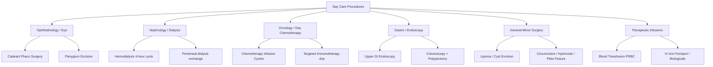
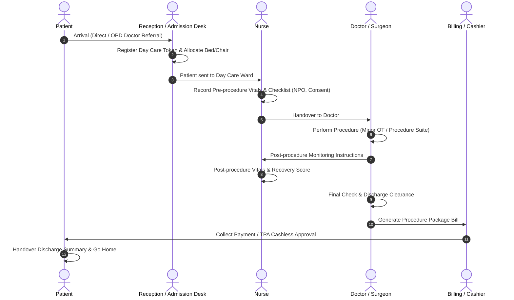

# Plan 09 — Hospital Day Care Management System

> **Scope:** End-to-end Architecture, Workflow, Database Schema, API Design, aur UI Layout for Day Care (Same-Day Admission, Minor Surgery & Therapy) in HMIS.  
> **Target:** Hospital OPD, Dialysis, Chemo, Eye, Minor OT, and Insurance / ABDM Compliance.

---

## 1. Executive Overview & Problem Definition

### 1.1 Day Care Kya Hai?
Hospital me **Day Care** aisa specialized clinical workflow hai jisme patient:
- Subah admit hota hai
- Procedure / minor surgery / therapy karwata hai
- 2 se 8 ghante observation me rehta hai
- **Usi din shaam ko discharge hokar ghar chala jata hai** (No overnight stay).

### 1.2 OPD vs Day Care vs Full IPD Faraq

| Parameter | OPD (Out-Patient) | Day Care (Same-Day) | IPD (In-Patient) |
|---|---|---|---|
| **Duration** | 15–30 Mins | **2–8 Hours** | > 24 Hours (Multiple days) |
| **Bed Requirement** | Nahi | **Haan (Day Care Bed / Recliner)** | Full Hospital Ward / ICU Bed |
| **Clinical Severity** | Consultation, Checkup | Minor OT, Dialysis, Chemo, Endoscopy | Major Surgery, Critical Illness |
| **Discharge Summary** | Prescription Slip | **Same-day Discharge Summary** | Comprehensive IPD Discharge Summary |
| **Insurance / TPA** | OPD cover rarely | **500+ Listed Day Care Packages (Covered)** | Standard Inpatient Mediclaim |

---

## 2. Typical Clinical Use-Cases (Procedures in Day Care)



---

## 3. Patient Journey & Workflow (Step-by-Step)



### 6 Stages of Day Care Lifecycle:
1. **Stage 1 — Admission & Bed Allocation:**
   - Patient arrives with doctor referral or routine dialysis/chemo schedule.
   - Bed / Recliner chair allocated (e.g. `DC-BED-01`, `CHAIR-04`).
   - Day Care Admission ID (`DC-2026-00124`) generated.
2. **Stage 2 — Pre-Procedure Prep (Nurse):**
   - Vitals recorded (BP, Pulse, SpO2, Temp, Sugar).
   - Pre-Op Checklist: Consent signed, NPO (fasting) status, allergy history verified.
3. **Stage 3 — Procedure Execution (Doctor/Specialist):**
   - Performed in Minor OT, Dialysis Unit, or Endoscopy Room.
   - Doctor notes anesthesia used (Local/Short GA), implants/consumables used, procedure findings.
4. **Stage 4 — Recovery & Post-Op Observation:**
   - Patient rests on Day Care bed/recliner.
   - Nurse monitors vitals every 30-60 mins until patient is stable and alert.
5. **Stage 5 — Doctor Sign-off & Discharge Summary:**
   - Doctor checks recovery, prescribes post-discharge medications, next follow-up date.
   - Generates same-day clinical discharge slip.
6. **Stage 6 — Billing & Settlement:**
   - Package billing (e.g. "Cataract Package ₹15,000" or "Dialysis Session ₹1,800").
   - Pharmacy/consumables settlement. Bed marked `Cleaning` -> `Available`.

---

## 4. Database Schema Design

### 4.1 Table: `day_care_admissions`
```sql
CREATE TABLE day_care_admissions (
    id BIGSERIAL PRIMARY KEY,
    hospital_id BIGINT NOT NULL REFERENCES hospitals(id),
    patient_id BIGINT NOT NULL REFERENCES patients(id),
    dc_number VARCHAR(50) UNIQUE NOT NULL,      -- e.g. DC-2026-0001
    doctor_id BIGINT NOT NULL REFERENCES doctors(id),
    department_id BIGINT NOT NULL REFERENCES departments(id),
    ward_id BIGINT NULL REFERENCES wards(id),
    bed_id BIGINT NULL REFERENCES beds(id),
    
    -- Clinical Details
    procedure_name VARCHAR(255) NOT NULL,       -- e.g. Hemodialysis, Cataract Right Eye
    procedure_code VARCHAR(100) NULL,           -- ICD-10 or PMJAY Package Code
    diagnosis TEXT NULL,
    referring_opd_visit_id BIGINT NULL REFERENCES opd_visits(id),
    
    -- Status Tracker
    status VARCHAR(30) NOT NULL DEFAULT 'admitted', 
    -- 'admitted', 'in_procedure', 'in_recovery', 'discharge_cleared', 'discharged', 'transferred_to_ipd', 'cancelled'
    
    -- Time Milestones
    admitted_at TIMESTAMP NOT NULL DEFAULT CURRENT_TIMESTAMP,
    procedure_started_at TIMESTAMP NULL,
    procedure_ended_at TIMESTAMP NULL,
    discharged_at TIMESTAMP NULL,
    
    -- Clinical Notes
    pre_op_notes TEXT NULL,
    procedure_notes TEXT NULL,
    post_op_instructions TEXT NULL,
    discharge_advice TEXT NULL,
    follow_up_date DATE NULL,
    
    -- Financials
    package_name VARCHAR(150) NULL,
    package_amount DECIMAL(10,2) DEFAULT 0.00,
    total_amount DECIMAL(10,2) DEFAULT 0.00,
    discount DECIMAL(10,2) DEFAULT 0.00,
    amount_paid DECIMAL(10,2) DEFAULT 0.00,
    payment_status VARCHAR(30) DEFAULT 'pending', -- pending, paid, partial, insurance_pending
    payment_method VARCHAR(50) DEFAULT 'cash',
    
    created_at TIMESTAMP DEFAULT CURRENT_TIMESTAMP,
    updated_at TIMESTAMP DEFAULT CURRENT_TIMESTAMP
);

CREATE INDEX idx_dc_hospital_status ON day_care_admissions(hospital_id, status);
CREATE INDEX idx_dc_patient ON day_care_admissions(patient_id);
CREATE INDEX idx_dc_date ON day_care_admissions(admitted_at);
```

### 4.2 Table: `day_care_vitals`
```sql
CREATE TABLE day_care_vitals (
    id BIGSERIAL PRIMARY KEY,
    day_care_admission_id BIGINT NOT NULL REFERENCES day_care_admissions(id) ON DELETE CASCADE,
    recorded_by BIGINT REFERENCES users(id),
    stage VARCHAR(30) NOT NULL, -- 'pre_procedure', 'intra_procedure', 'recovery', 'discharge'
    bp_systolic INT NULL,
    bp_diastolic INT NULL,
    pulse INT NULL,
    spo2 INT NULL,
    temperature DECIMAL(4,1) NULL,
    blood_sugar DECIMAL(5,1) NULL,
    consciousness_level VARCHAR(50) NULL, -- 'alert', 'drowsy', 'oriented'
    notes TEXT NULL,
    recorded_at TIMESTAMP DEFAULT CURRENT_TIMESTAMP
);
```

---

## 5. API Endpoints Specification

### 5.1 Admission & Management
| Method | Endpoint | Description |
|---|---|---|
| `GET` | `/api/v1/day-care` | List active & today's day care patients (filters: status, doctor, dept) |
| `POST` | `/api/v1/day-care/admit` | Create new Day Care admission & allocate bed/chair |
| `GET` | `/api/v1/day-care/{id}` | Complete 360 Day Care view (Patient, Vitals, Procedure, Billing) |
| `PATCH` | `/api/v1/day-care/{id}/status` | Update progress: `admitted` → `in_procedure` → `in_recovery` |
| `GET` | `/api/v1/day-care/beds` | Available Day Care Beds / Recliner Chairs status |

### 5.2 Clinical & Vitals
| Method | Endpoint | Description |
|---|---|---|
| `POST` | `/api/v1/day-care/{id}/vitals` | Record Pre-Op / Recovery vitals |
| `POST` | `/api/v1/day-care/{id}/notes` | Save doctor procedure notes & surgical findings |
| `POST` | `/api/v1/day-care/{id}/checklist` | Pre-procedure checklist sign-off (Nurse) |

### 5.3 Discharge & Billing
| Method | Endpoint | Description |
|---|---|---|
| `POST` | `/api/v1/day-care/{id}/discharge` | Complete discharge, release bed, print discharge slip |
| `POST` | `/api/v1/day-care/{id}/transfer-ipd` | Escalate to regular IPD if patient needs overnight stay |
| `GET` | `/api/v1/day-care/{id}/discharge-summary` | Printable PDF/HTML Discharge Summary with ABHA |

---

## 6. Frontend UI/UX Architecture

```
Frontend Navigation:
├── Top Navigation
│   └── "Day Care Desk" (Badge showing: Active: 8 | Recovery: 3)
│
├── Tab 1: Live Day Care Floor Grid (Beds & Recliners)
│   ├── Color Coded Cards:
│   │   ├── Bed 01: [In Procedure] - Cataract OD (Dr. Verma) - 45m elapsed
│   │   ├── Bed 02: [Recovery] - Dialysis Cycle (4/4 hrs complete) - BP 120/80
│   │   ├── Bed 03: [Vacant / Ready]
│   │   └── Bed 04: [Cleaning]
│
├── Tab 2: Today's Admission & Procedure List
│   ├── Table with Quick Actions:
│   │   ├── [Enter Vitals]
│   │   ├── [Procedure Notes]
│   │   └── [1-Click Discharge & Bill]
│
├── Tab 3: New Day Care Admission (Modal / Form)
│   ├── Search Patient (UHID / Mobile / ABHA)
│   ├── Procedure Picker (Predefined package or custom)
│   ├── Doctor & Department
│   └── Bed / Recliner selector
│
└── Tab 4: Discharge History & Analytics
```

---

## 7. ABDM & Insurance Compliance for Day Care

1. **ABDM M1 & M2 Care-Context Integration:**
   - Day Care visit generates an ABDM Care Context:
     `CareContext Type: DayCareProcedure` (e.g. `DC-2026-0001: Hemodialysis`).
   - Linked to patient's 14-digit ABHA Number.
2. **Standardized Discharge Summary (FHIR):**
   - FHIR `Composition` of type `DischargeSummary` with same-day timestamps.
3. **Ayushman Bharat (PM-JAY) & TPA Cashless:**
   - 500+ Day Care procedures pre-approved under PM-JAY without 24-hr hospitalization mandate.

---

## 8. Rollout Phases (Execution Roadmap)

```
Phase 1: Database & Core Backend (Week 1)
├── Migration: day_care_admissions, day_care_vitals
├── DayCareService & DayCareController
└── Bed allocation linkage with existing wards/beds

Phase 2: Frontend Day Care Desk (Week 2)
├── Bed & Recliner Grid View (Live Status)
├── Day Care Admission Form with Patient Picker
└── Pre-procedure & Recovery Vitals Modal

Phase 3: Clinical Discharge & Billing Integration (Week 3)
├── Same-day Discharge Summary Generator
├── Package Billing & Multi-mode receipt
└── ABDM Health Record linking & Emergency escalation to IPD
```
