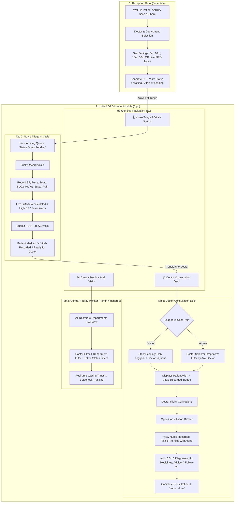

# 10. Unified OPD Master Module: Doctor Desk, Nurse Triage, Slot Settings & Role Scoping

> **Document Version:** 2.0.0 (Updated with Unified OPD Sub-Navigation)  
> **Target Modules:** OPD Master Module (`/opd`), Reception Appointment Scheduling, Hospital Settings  
> **Status:** Revised per User Request — Awaiting Final Approval  
> **Author:** Antigravity AI Engineering  

---

## 📌 Executive Summary & Architecture Philosophy

As per the user's specific guidance:
> *"opd ke andar hi header nav me baato ki opd ke andar gya toh uske andar bhi bahut kaam hoga nurse uske andar hi vitals n daalegi or sidebar me ek pura module rhega opd toh pura kaam opd ka uske andar rhegs"*

Rather than scattering OPD functions into separate sidebar entries, **OPD is structured as a single comprehensive clinical hub (`/opd`) in the sidebar**. 

Inside `/opd`, a modern **Header Sub-Navigation (Clinical Workstation Tabs)** divides the OPD operations into specialized stations:
1. 🩺 **Doctor Consultation Desk (`doctor-desk`)**: Doctor calls patients, examines pre-recorded vitals, issues ICD-10 diagnoses and ABDM e-prescriptions.
2. 🌡️ **Nurse Triage & Vitals Station (`triage`)**: Nurse records patient vitals (BP, Pulse, Temp, SpO2, Ht/Wt -> auto BMI, Blood Sugar, Pain Score) before doctor checkup.
3. 📊 **Central OPD Queue & Facility Monitor (`monitor`)**: Admin / Head Nurse view across all doctors and departments with filtering and token stats.
4. 📜 **Today's Completed Visits History (`history`)**: Log of all completed consultations today with prescription view/print.

---

## 🏛️ Unified OPD Workstation Layout

```
┌────────────────────────────────────────────────────────────────────────────────────────────────────────┐
│  SIDEBAR                 TOP HEADER: Hospital Name | ABDM Gateway Online | User Profile                │
│  ──────────              ────────────────────────────────────────────────────────────────────────────  │
│  Dashboard                                                                                             │
│  Reception               🏥 OPD CLINICAL WORKSTATION                                                  │
│  Patients                Comprehensive Outpatient Department Management Console                        │
│ ▶ OPD (Master)           ────────────────────────────────────────────────────────────────────────────  │
│  IPD Inpatient           [🩺 Doctor Consultation Desk] [🌡️ Nurse Triage & Vitals] [📊 Central Monitor] │
│  Emergency                                                                                             │
│  Billing                 ────────────────────────────────────────────────────────────────────────────  │
│  Doctors                 ACTIVE TAB CONTENT (Rendered Below Header Tabs)                              │
│  Settings                • Doctor Desk: Calls queue, consultation drawer, pre-filled vitals            │
│                          • Nurse Triage: Today's queue, "Record Vitals", auto-BMI, abnormal alerts     │
│                          • Central Monitor: Admin facility-wide overview with Doctor & Dept filters    │
└────────────────────────────────────────────────────────────────────────────────────────────────────────┘
```

---

## 🔄 End-to-End Clinical Flow inside OPD



---

## 📐 Detailed Module Specifications

### Module 1: Fixing OPD Queue Table & Data Bugs

#### 1.1 Root Cause of Current Screenshot
1. **Field Mismatch**: Backend `OpdService.php` returns Eloquent relational objects (`patient.name`, `patient.uhid`, `department.name`, `queue_token`, status in lowercase `'waiting'`), while the frontend table expects flat properties (`patient_name`, `token_no`, `department_name`, and uppercase `"WAITING"`).
2. **Invalid Date**: `row.check_in_time` was undefined, so `new Date(undefined)` threw `Invalid Date`.
3. **Missing Call Button & 0 Waiting Stats**: The table checked `row.status === "WAITING"`. Because the backend returned `'waiting'` in lowercase, the condition failed, hiding the `Call` button and displaying `0 Waiting` in stats.

#### 1.2 Data Normalization & Resilient Mappers
- Backend API and frontend mappers will provide both nested models and normalized flat fields:
  ```json
  {
    "id": 1,
    "visit_id": 1,
    "opd_number": "OPD-2026-0001",
    "queue_token": 1,
    "token_no": "1",
    "patient_name": "Bipin Kumar",
    "uhid": "UHID-2026-0001",
    "age": 28,
    "gender": "male",
    "department_name": "Cardiology",
    "doctor_name": "Dr. Sharma",
    "chief_complaint": "Chest discomfort",
    "visit_reason": "Chest discomfort",
    "status": "waiting",
    "check_in_time": "2026-10-08T12:35:00.000000Z",
    "created_at": "2026-10-08T12:35:00.000000Z",
    "has_vitals": true,
    "latest_vital": {
      "blood_pressure_sys": 120,
      "blood_pressure_dia": 80,
      "pulse_rate": 72,
      "temperature": 98.6,
      "oxygen_saturation": 99.0,
      "bmi": 22.4
    }
  }
  ```
- **Case-Insensitive Status Handling**:
  - Waiting: `s === 'waiting'`
  - In Consultation: `s === 'called' || s === 'in_consultation'`
  - Completed: `s === 'done' || s === 'completed'`
- **Restored Actions**:
  - If `waiting`: Displays primary **"Call Patient"** button.
  - If `called` or `in_consultation`: Displays emerald **"Active Desk"** button.
  - If `done`: Displays checkmark **"Completed"** badge.

---

### Module 2: Role-Based Isolation (Doctor vs Admin)

#### 2.1 Backend Role Guarding (`OpdController.php`)
- **Doctor User**:
  - If authenticated user has role `Doctor` (or has linked `Doctor` profile), backend strictly forces:
    `$doctorId = $doctor->id;`
  - Doctor receives **ONLY** their assigned patients. Tampering with query parameters is blocked on backend.
- **Admin User (`HOSPITAL_ADMIN`, `SUPER_ADMIN`)**:
  - Receives queue across all doctors in the hospital.
  - Can pass optional `?doctor_id=...` and `?department_id=...` to filter the view.

#### 2.2 Auto-Resolving Doctor on Action Endpoints
- In `POST /api/v1/opd/visit/{id}/call` and `POST /api/v1/opd/visit/{id}/complete`:
  - If the user is a Doctor, auto-detect `$doctorId = $doctor->id`.
  - If the user is an Admin, auto-resolve `$doctorId = $visit->doctor_id`.

---

### Module 3: Flexible & Robust Slot Settings Architecture

#### 3.1 Hospital Settings Data Model (`HospitalSetting`)
Stored under setting group `'opd_slot'`:
| Setting Key | Type | Allowed Values | Default | Description |
|---|---|---|---|---|
| `slot_duration_minutes` | integer | `5`, `10`, `15`, `20`, `30`, `45`, `60` | `15` | Default duration of consultation slot |
| `opd_morning_start` | string | Time (`HH:mm`) | `09:00` | Hospital OPD morning session start |
| `opd_morning_end` | string | Time (`HH:mm`) | `13:00` | Hospital OPD morning session end |
| `opd_evening_start` | string | Time (`HH:mm`) | `17:00` | Hospital OPD evening session start |
| `opd_evening_end` | string | Time (`HH:mm`) | `21:00` | Hospital OPD evening session end |
| `max_patients_per_slot` | integer | `1`, `2`, `3`, `5`, `10` | `1` | Max patients allowed per time slot |
| `allow_fifo_live_token` | boolean | `true`, `false` | `true` | Allow live walk-in tokens without time slot |

#### 3.2 Dynamic Slot Generator Algorithm (`slotGenerator.ts`)
- Replaces the hardcoded 30-min static options in [WalkInFlow.tsx](file:///c:/Users/Employee/Desktop/hospital/frontend/src/components/reception/WalkInFlow.tsx) and [DeptDoctorPicker.tsx](file:///c:/Users/Employee/Desktop/hospital/frontend/src/components/reception/DeptDoctorPicker.tsx).
- When a doctor is selected, the generator inspects the doctor's active schedule for today (or hospital default shift) and slices the shift into exact intervals according to `slot_duration_minutes`:
  - **15 min setting**: `09:00 - 09:15`, `09:15 - 09:30`, `09:30 - 09:45`, etc.
  - **5 min setting**: `09:00 - 09:05`, `09:05 - 09:10`, `09:10 - 09:15`, etc.
  - **30 min setting**: `09:00 - 09:30`, `09:30 - 10:00`, etc.
- Always includes:
  `⚡ Next Available Token (Live Queue - FIFO)` at the top for immediate walk-in registration.

#### 3.3 Settings Management UI (`SettingsPage.tsx`)
- Add **"OPD & Appointment Slot Engine"** card:
  - Duration selector buttons: `[ 5 Min ] [ 10 Min ] [ 15 Min ] [ 20 Min ] [ 30 Min ] [ 45 Min ] [ 60 Min ]`
  - Shift time pickers (Morning Start/End, Evening Start/End).
  - Max capacity per slot numeric input.
  - FIFO Live Token toggle.

---

### Module 4: Inside OPD — Header Sub-Navigation & Nurse Triage Tab

#### 4.1 Header Sub-Navigation in `OpdPage.tsx`
Inside `/opd`, render a responsive, tabbed header navigation:
- **Tab 1: 🩺 Doctor Consultation Desk** (`doctor-desk`)
  - Target: Doctors and Admins.
  - Default tab for users with role `DOCTOR`.
  - Shows Doctor's patient queue, stats counters, "Call Patient" button, and "Active Desk" button.
- **Tab 2: 🌡️ Nurse Triage & Vitals Station** (`triage`)
  - Target: Nurses, Receptionists, and Admins.
  - Default tab for users with role `NURSE` or `RECEPTIONIST`.
  - Shows today's registered OPD patients with `⚠ Vitals Pending` vs `✓ Vitals Recorded` status.
  - Instant **"Record Vitals"** trigger for any patient.
- **Tab 3: 📊 Central OPD Monitor** (`monitor`)
  - Target: Hospital Admin and Medical Superintendent.
  - Full hospital-wide overview with Doctor Filter, Department Filter, and live bottleneck metrics.
- **Tab 4: 📜 Consultations History** (`history`)
  - List of all completed OPD visits today, diagnoses issued, and prescription summary.

#### 4.2 Comprehensive Nurse Triage Station (`OpdTriageTab.tsx`)
1. **Live Patient Queue**:
   - Patient Info: Name, UHID, Token #, Age, Gender, Chief Complaint, Doctor assigned.
   - Vitals Status:
     - `⚠ Vitals Pending` (Pulsing amber badge) -> Button: **[ Record Vitals ]**
     - `✓ Vitals Recorded` (Green badge) -> Displays summary chips: `BP: 120/80` • `Pulse: 76` • `SpO2: 99%` • `Temp: 98.4°F` • `BMI: 22.4`
2. **Clinical Vitals Recording Modal (`RecordVitalsModal.tsx`)**:
   - **Blood Pressure**: Systolic & Diastolic (mmHg) with automated alerts for Hypotension & Hypertension.
   - **Pulse Rate**: bpm (flags Bradycardia < 50, Tachycardia > 100).
   - **Body Temperature**: Numeric with unit toggle (`°F` / `°C`) (flags Fever > 100°F).
   - **SpO2**: % (flags Hypoxia < 95%).
   - **Respiratory Rate**: breaths/min (12-20 normal).
   - **Height (cm) & Weight (kg) with Real-Time Auto-Calculated BMI**:
     - Automatically calculates BMI and displays category chip: `Underweight (<18.5)`, `Normal (18.5-24.9)`, `Overweight (25-29.9)`, `Obese (≥30)`.
   - **Blood Glucose**: mg/dL with Meal Context (`Random`, `Fasting`, `Post-Meal`).
   - **Pain Score**: Visual 0 to 10 Wong-Baker scale.
   - **Dynamic Hospital Vitals**: Loads custom fields configured in Settings (`vital_field_configs`).
   - **Clinical Notes**: Nurse remarks and allergy warnings.
   - **Save Action**: Submits to `POST /api/v1/vitals`. Marks patient as `✓ Vitals Recorded`.
3. **Automatic Handoff to Doctor Desk**:
   - Once saved by the nurse in Tab 2, the patient immediately reflects as `Ready for Doctor` in Tab 1.
   - When the doctor calls the patient into the consultation room, the vitals recorded by the nurse are **already pre-filled at the top of the consultation desk** with abnormal alerts highlighted. The doctor does not need to re-enter anything.

---

## 🗂️ File Impact & Modification Plan

| File Path | Role | Scope of Changes |
|---|---|---|
| `backend/app/Models/User.php` | Backend Model | Add `doctor()` relation (`hasOne(Doctor::class)`). |
| `backend/app/Http/Controllers/Api/V1/OpdController.php` | Backend Controller | Implement role scoping (Doctor sees only own queue, Admin sees all with filter), auto-resolve `doctor_id` on call/complete. |
| `backend/app/Services/Opd/OpdService.php` | Backend Service | Support department and doctor filtering, eager load vitals relation, format response fields. |
| `frontend/src/types/opd.ts` | Frontend Types | Extend `OpdVisit` interface with fallback and relational mappings. |
| `frontend/src/services/opdService.ts` | Frontend Service | Update `getQueue` to accept optional `doctorId`, `departmentId`, `status`. Ensure `callPatient` accepts optional payload. |
| `frontend/src/pages/opd/OpdPage.tsx` | Frontend Master Page (New) | OPD Master Container with **Header Sub-Navigation Tabs** (`Doctor Consultation Desk`, `Nurse Triage & Vitals`, `Central Monitor`, `Consultation History`). |
| `frontend/src/pages/opd/tabs/OpdDoctorDeskTab.tsx` | Frontend Tab Component | Doctor consultation desk, fixed table display, Call button, Active Desk, Consultation Drawer with pre-filled nurse vitals. |
| `frontend/src/pages/opd/tabs/OpdTriageTab.tsx` | Frontend Tab Component | Dedicated Nurse Triage & Vitals Queue, quick "Record Vitals" trigger, live vitals summary chips. |
| `frontend/src/pages/opd/tabs/OpdCentralMonitorTab.tsx` | Frontend Tab Component | Admin facility-wide monitor with Doctor & Department filters and token metrics. |
| `frontend/src/components/triage/RecordVitalsModal.tsx` | Frontend Component | Clinical Vitals entry modal with live BMI calculation, abnormal threshold alerts, and dynamic custom vitals. |
| `frontend/src/utils/slotGenerator.ts` | Frontend Utility | Dynamic time slot generator supporting 5m to 60m intervals and FIFO live tokens. |
| `frontend/src/components/reception/WalkInFlow.tsx` | Frontend Component | Replace static options with dynamic slots driven by doctor's schedule and hospital slot setting. |
| `frontend/src/components/reception/DeptDoctorPicker.tsx` | Frontend Component | Replace static options with dynamic slots. |
| `frontend/src/pages/settings/SettingsPage.tsx` | Frontend Page | Add "OPD & Appointment Slot Settings" tab/card to configure slot duration (5m - 60m), shift timings, and capacity. |
| `frontend/src/App.tsx` | Frontend Routing | Update `/opd` route to load the unified `OpdPage`. |

---

## 🚀 Execution Steps (Upon Your Approval)

1. **Step 1: Backend Scoping & Data Normalization**
   - Add `doctor()` relation in `User.php`.
   - Update `OpdController.php` for strict Doctor isolation vs Admin multi-doctor view.
   - Normalize `OpdService.php` return payload with both nested models and flat fallbacks.
2. **Step 2: Unified OPD Master Container & Header Tabs**
   - Create `OpdPage.tsx` with header workstation tabs (`Doctor Desk`, `Nurse Triage`, `Central Monitor`).
   - Fix table mapping bugs (Token #, Name, Dept, Date, and Call button).
   - Wire Doctor Desk with pre-filled nurse vitals.
3. **Step 3: Dedicated Nurse Triage Station inside OPD**
   - Implement `OpdTriageTab.tsx` and `RecordVitalsModal.tsx`.
   - Add auto-BMI calculation, abnormal alert flags, and dynamic custom vitals support.
4. **Step 4: Hospital Settings & Dynamic Slot Generator**
   - Add OPD Slot Duration setting (5m, 10m, 15m, 20m, 30m, 45m, 60m) in `SettingsPage.tsx`.
   - Implement `slotGenerator.ts` and connect with `WalkInFlow.tsx` & `DeptDoctorPicker.tsx`.
5. **Step 5: End-to-End Clinical Verification**
   - Test walk-in dynamic slot -> Patient appears in Nurse Triage tab -> Nurse records vitals -> Patient moves to Doctor Desk tab -> Doctor calls patient and sees nurse vitals pre-filled -> Admin views Central Monitor.
